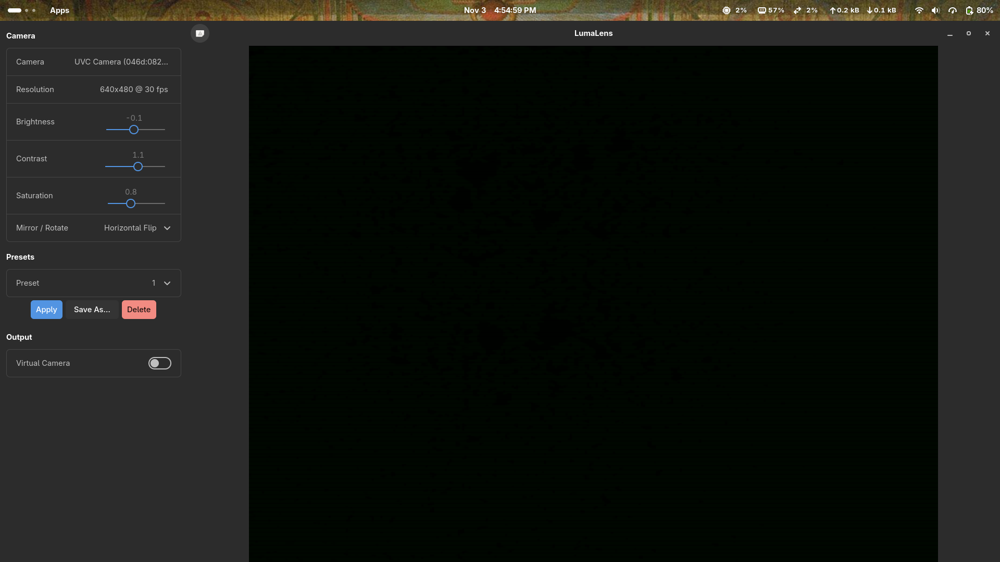

# LumaLens

> **Status: pre-alpha — expect rough edges.**

LumaLens is a webcam studio for Linux. It gives you a live preview of your
camera with real-time image adjustments, then pipes the result to a
system-wide virtual webcam so every app — Meet, Zoom, OBS — sees your
tuned feed. No browser extensions, no Electron, just native GTK4 and
GStreamer.

<!-- TODO: add a screenshot here once the UI is stable -->
<!--  -->

## Features

- **Live camera preview** with hardware-accelerated rendering via
  `gtk4paintablesink`.
- **Brightness control** — real-time adjustment through GStreamer's
  `videobalance`.
- **Virtual camera output** — feed your adjusted video to any app via
  v4l2loopback.
- **Multi-camera support** — switch between connected cameras from a
  dropdown.
- **Hot-plug detection** — cameras are discovered automatically when
  plugged in and removed gracefully when unplugged.
- **Collapsible sidebar** with camera and output controls.

## Install (build from source)

### Arch Linux

```bash
sudo pacman -S --needed \
  base-devel rust \
  gtk4 libadwaita \
  gstreamer gst-plugins-base gst-plugins-good gst-plugins-bad gst-libav \
  v4l-utils
```

### Fedora

```bash
sudo dnf install \
  gcc rust cargo \
  gtk4-devel libadwaita-devel \
  gstreamer1-devel gstreamer1-plugins-base-devel \
  gstreamer1-plugins-good gstreamer1-plugins-bad-free \
  v4l-utils
```

### Build and run

```bash
cargo run
```

### Virtual camera (optional)

To use the virtual camera output, load the `v4l2loopback` kernel module:

```bash
sudo modprobe v4l2loopback video_nr=10 card_label="LumaLens" exclusive_caps=1
```

To persist across reboots, see the
[v4l2loopback documentation](https://github.com/umlaeute/v4l2loopback).

## Roadmap

See the [issue tracker](../../issues) for planned work. Key areas:

- Contrast, saturation, and white-balance controls
- Mirror / rotate transforms
- Per-camera preset profiles (save/load)
- Flatpak packaging
- CI with GitHub Actions

## Contributing

Contributions are welcome! See [CONTRIBUTING.md](CONTRIBUTING.md) for
development setup, code style, and PR guidelines.

## License

[GPL-3.0-or-later](LICENSE)
