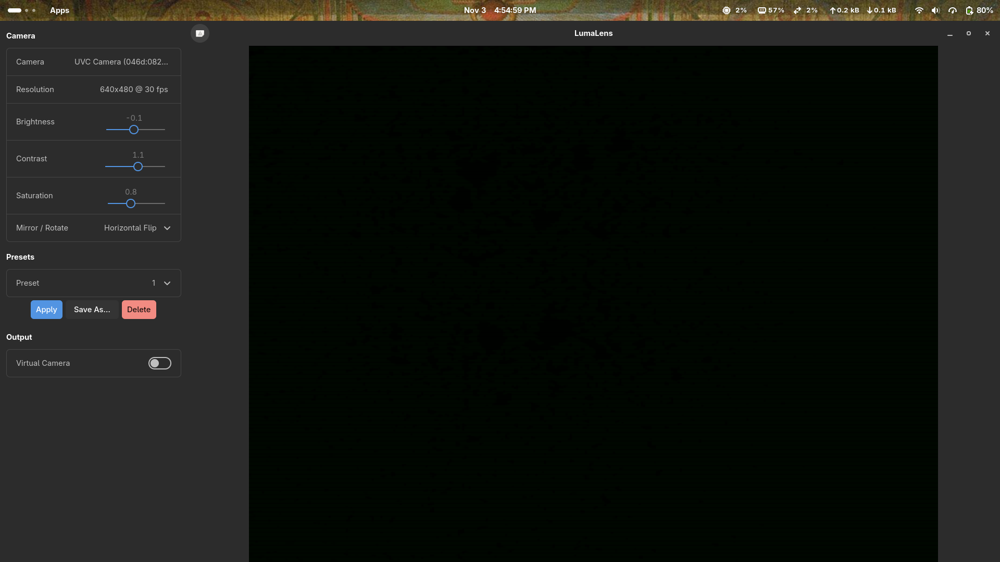

# LumaLens 0.1.0

**Release date:** 2026-11-03

The first public release of LumaLens — a webcam studio for Linux built
with GTK4 and GStreamer.

<!-- Replace with an actual screenshot before publishing -->
<!--  -->

## What's In

- **Live camera preview** — hardware-accelerated rendering via
  `gtk4paintablesink` in a native libadwaita window.
- **Image adjustments** — brightness, contrast, and saturation sliders
  that update the pipeline in real time.
- **Mirror / rotate** — six transforms (horizontal/vertical flip,
  90°/180°/270° rotation).
- **Runtime resolution switching** — choose from camera-supported
  presets (640×480@30, 1280×720@30, 1280×720@60, 1920×1080@30).
- **Virtual camera output** — toggle a v4l2loopback feed so every app
  on the system sees the tuned video.
- **Multi-camera support** — switch between cameras without restarting.
- **Image presets** — save, load, and delete named profiles. Three
  built-in presets (Natural, Warm, Cool) ship out of the box.
- **Config persistence** — all settings saved to
  `$XDG_CONFIG_HOME/lumalens/config.toml` with atomic writes and
  schema migration.
- **Hot-plug detection** — cameras appear and disappear dynamically.
- **Error recovery** — camera disconnections are handled gracefully
  with user-visible toasts and automatic re-discovery.

## What's Not (Yet)

- AI effects (background blur, segmentation) — planned for a future
  release behind an optional feature flag.
- Audio handling — LumaLens is video-only.
- Flatpak / AUR packaging — build from source for now.
- macOS / Windows support — Linux only.

## Install

### Dependencies

**Arch Linux:**

```bash
sudo pacman -S --needed \
  base-devel rust \
  gtk4 libadwaita \
  gstreamer gst-plugins-base gst-plugins-good gst-plugins-bad gst-libav \
  v4l-utils
```

**Fedora:**

```bash
sudo dnf install \
  gcc rust cargo \
  gtk4-devel libadwaita-devel \
  gstreamer1-devel gstreamer1-plugins-base-devel \
  gstreamer1-plugins-good gstreamer1-plugins-bad-free \
  v4l-utils
```

### Build

```bash
git clone https://github.com/TimsTittus/lumalens.git
cd lumalens
cargo run --release
```

### Virtual camera (optional)

```bash
sudo modprobe v4l2loopback video_nr=10 card_label="LumaLens" exclusive_caps=1
```
